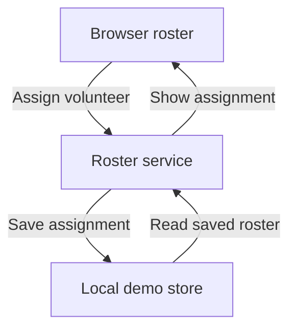

# Application example: a browser task before deployment details

> **Fictional example — not working instructions or evidence.** Fictional
> ShiftSlate, its paths, packages, commands, results, URLs, badges, diagrams, and
> any described screenshots are illustrative. Nothing below establishes a real
> project's behavior, supported environment, release, or validation status.

This sample assumes a browser application for volunteer coordinators. Their
first need is to assign a shift and see the assignment stick; operators have a
different task. The order follows those needs, not a universal README outline.

## Annotated sample

````markdown
# Fictional ShiftSlate

Plan volunteer shifts and see which ones still need a person. ShiftSlate is for
coordinators who currently reconcile sign-up messages with a separate roster.

[](https://github.com/fictional-readme-examples/shiftslate/releases)

Assign a volunteer and reload the roster to see the saved assignment:



## Try assigning a shift

Use the local demo to explore the roster with generated volunteers. You need
Node.js 22, npm, a checkout of this repository, and a browser. Run these commands
from the checkout root; package installation needs registry access.

```sh
npm ci
npm run demo
```

Wait for the terminal to report `Demo ready at http://localhost:4310` and open
that address in your browser. This demo keeps its own local data; use generated
names rather than information about real volunteers.

1. Open **Saturday market** and choose the unassigned **Welcome desk** shift.
2. Select **Mira Demo** and click **Assign**.
3. Refresh the page. The shift should still show **Mira Demo**, and its
   **Unassigned** label should be gone.

That persisted assignment is your first successful result. Stop the demo with
Ctrl+C. Its local roster remains for the next session; the reset instructions
in `docs/demo.md` explain what gets deleted before you reset it.

## What coordinators can do next

| Task | Where to start |
| --- | --- |
| Find gaps in a roster | Select **Unassigned** in the shift list |
| Move a volunteer to another shift | Open the assignment and choose **Move** |
| Share a roster for printing | Choose **Export** to download a CSV |

An exported CSV is a separate copy. Changing it does not update the roster.

## Before using this for a real event

The demo does not configure event membership or production access controls.
An operator must complete the setup in `docs/operations.md` before inviting
real volunteers.

Coordinators can use `docs/coordinator-guide.md` for roster changes and exports.
Operators can use `docs/operations.md` for configuration, backups, restoration,
and upgrades. Contributors can use `docs/development.md` to run checks and
change the application.
````

## Why these choices fit this application

- **Value:** The opening names the coordination problem and the reader. A list
  of frameworks would not help someone decide whether this solves their task.
- **First success:** Installation is only preparation. Named browser controls,
  refresh, and a persistent assignment make success recognizable. For a real
  hosted product, its supported sign-in path may replace this local demo.
- **Diagram:** The save/read loop explains where an assignment goes and why
  refreshing is part of the task. Verify the service and storage boundaries
  against the actual demo; the diagram describes a flow, not a successful run.
- **Dynamic release badge:** It reads the version from GitHub Releases and
  links to that authoritative page. This avoids manually copying versions,
  release notes, or summaries into the README. Verify the repository, badge
  source, release filtering, and destination; replace the fictional owner and
  repository. Readers get release history without a second copy to maintain.
- **Screenshot:** Put a real capture after the assignment steps to help readers
  locate the shift and recognize its saved state. Capture the current UI using
  demo data, crop to the relevant controls, and explain the state in a caption.
  No screenshot image is supplied here.
- **Useful depth:** The task table offers next actions. The separate operator
  route keeps configuration details available without making coordinators read
  deployment internals. Real deeper documents should become verified links.
- **Limits:** Demo data, access setup, export behavior, and retained local
  state affect reader actions. Each needs support in the actual project.

## Adapting and checking

Inspect scripts, demo fixtures, UI labels, persistence behavior, and existing
operator documentation before borrowing any wording. Confirm that the full
start-to-refresh path works in the stated environment. Replace the sample
requirements, address, paths, and output with what the project actually provides.
Check diagram labels and badge legibility on the publishing host at wide and
narrow widths. URLs use the fictional `fictional-readme-examples` owner and do
not establish a real release. Rendering checks diagram syntax and presentation;
it does not validate the application's behavior.

Keep evidence distinct: source inspection can establish a script's intent;
a local browser run can demonstrate this task; CI results only establish the
checks that CI ran. A screenshot shows one captured state, not persistence or
access-control correctness. Neither a release badge nor CI replaces that evidence.

For a focused correction, change the affected instructions and proof only.
For review-only work, report gaps without editing the README or running actions
that change application data.
