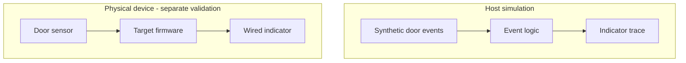

# Embedded example: host simulation before physical deployment

> **Fictional example — not working instructions or evidence.** Fictional
> LanternBench, its paths, packages, commands, results, URLs, badges, diagrams,
> and any described screenshots are illustrative. Nothing below establishes a
> real project's behavior, supported environment, release, or validation status.

This sample serves firmware integrators evaluating a door indicator, then
operators preparing a board. A host simulation gives a first useful result
without making a physical action the entry point. This order suits this example;
it is not a universal embedded-project outline.

## Annotated sample

````markdown
# Fictional LanternBench

Show whether a storage-room door is open using a door sensor and an indicator.
LanternBench is for integrators assembling that device and operators maintaining
it. Evaluate the event logic on your computer before choosing or wiring a board.

[](https://github.com/fictional-readme-examples/lanternbench/actions/workflows/host-ci.yml?query=branch%3Amain)

The badge covers Linux host simulation tests. Physical door and indicator
behavior requires a separate check on the intended board and wiring.



## Run a door cycle without hardware

You need a Linux host, Rust 1.85 with Cargo, and this repository checkout.
Run from the checkout root. The initial build needs access to the dependency
registry; no connected board, flashing tool, or elevated privileges are needed.

The bundled `examples/door-cycle.json` contains this event sequence:

```json
[{"door":"open"},{"door":"closed"}]
```

```sh
cargo run --locked --bin lantern-sim -- \
  --events examples/door-cycle.json --storage memory
```

Expected event trace:

```text
door=open indicator=on
door=closed indicator=off
simulation complete; state discarded
```

Success means both events produce the expected indicator state and the command
exits successfully. This simulation uses synthetic input and memory storage;
it neither opens hardware interfaces nor writes device firmware.

## What that result does and does not establish

The trace demonstrates event handling in the host simulator. It does not test
sensor wiring, electrical levels, debounce timing, indicator polarity,
persistent state after power loss, or behavior on the target processor.

Consult `docs/boards.md` for explicitly listed board revisions; a matching
connector alone does not establish board support.

## Before flashing a physical board

Use `docs/bring-up.md` to check all prerequisites for the selected board:

- Exact board revision, firmware target, and required bootloader version.
- Sensor and indicator pin mapping, voltage levels, and supply requirements.
- A supported programmer, connection method, and permission setup.
- Whether flashing erases settings; export any retained data first.
- A verified recovery image and a way to enter recovery mode.

Stop if those details are missing or disagree with the actual hardware. Follow
the board-specific procedure rather than adapting simulator arguments into a
flash command. Physical validation must check the real door transitions,
indicator behavior, reboot, and recovery with the intended wiring.

Integrators can continue with `docs/event-interface.md` for input and state
semantics. Operators can use `docs/bring-up.md` for deployment and recovery.
Firmware contributors can use `docs/development.md` for builds and host checks.
````

## Why these choices fit this system

- **Value and first success:** The physical purpose is clear before toolchain
  details. A bounded door cycle gives readers something to evaluate without
  requiring hardware purchase or modification.
- **Simulation boundary:** Inputs, state lifetime, and expected trace are
  explicit. In a real repository, inspect simulator initialization to verify
  that it cannot open hardware interfaces or modify a device. A binary named
  `sim` is not sufficient evidence of isolation.
- **Physical prerequisites:** Target selection, voltage, erased data, and
  recovery belong before flashing because they change whether proceeding is
  appropriate. No generic flash command is supplied for an unspecified board.
- **Diagram:** Two separate paths show synthetic events producing a trace and
  a real sensor driving a wired indicator. There is no implied host-to-board
  test result. Verify the actual backend and signal paths before adaptation.
- **Host-CI badge:** It identifies the check scope and links to its workflow.
  Verify the workflow URL, badge endpoint, branch/revision, jobs, and test
  coverage; the words "host CI" must not mask a build-only check. A passing
  workflow does not establish physical behavior. Replace the fictional owner,
  repository, workflow, and branch with the actual endpoints.
- **Further visuals and depth:** A verified board-specific pinout belongs in
  the bring-up guide when it helps wiring. Keep audience routes and support
  details available; no hardware photo or support claim is evidence here.

## Adapting and checking

Inspect manifests, event fixtures, simulator backends, target definitions,
bring-up instructions, and recovery behavior. Verify real reference targets.
Run the documented host command and check its exit status and actual trace.
Inspect diagram rendering and badge legibility at wide and narrow widths on
the publishing host. The workflow URL and badge are fictional. Rendering the
diagram checks its syntax and presentation, not firmware or hardware behavior.

Report evidence separately: source inspection establishes what was inspected;
a local simulation establishes host behavior; CI reports the jobs and targets
it ran; physical checks identify the board revision, firmware, setup, and
observations. Neither a host trace nor a cross-build establishes hardware success.

No simulation or physical test was performed for this fictional sample. Keep
edits within the requested documentation scope. Review-only work must remain
read-only, and documentation work alone does not authorize flashing a device.
